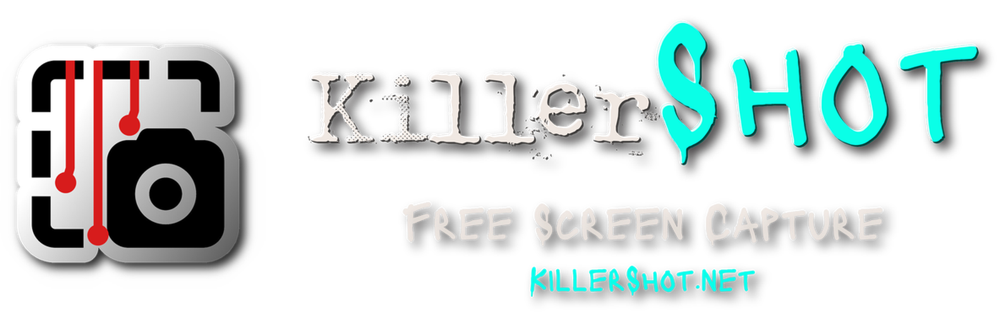

<p align="center">
  <a href="https://killershot.net"></a>
</p>

Free and open-source screenshot and screen recording tool for Windows. KillerShot copies exactly what you select, pixel for pixel, with an editor for marking it up and a recorder for MP4 and GIF. Captures go straight to the clipboard, so a picture is ready to paste before you let go of the mouse.

KillerShot is in development. Public downloads are not available yet.

How-tos and every shortcut are on the [help page](https://killershot.net/help.html). The capture and recording pipelines, DPI handling and encoder limits are on the [technical page](https://killershot.net/technical.html).

## Features

- Print Screen taken over: plain Print Screen repeats the last mode, Alt+Print Screen takes the active window, Ctrl+Print Screen the monitor under the pointer, Shift+Print Screen every monitor, and Ctrl+Shift+Print Screen starts or stops a recording. Every shortcut can be changed or turned off
- Region capture over a frozen copy of the whole desktop, so open menus and tooltips stay in the picture and the selection overlay never does. Drag across monitors with different scaling, hover to highlight a window and click to take it
- Window capture through Windows Graphics Capture, so a partly covered window still comes out whole, with its rounded corners filled from the desktop behind it
- Every capture goes to the clipboard as PNG and as a standard bitmap, and can also save straight into a folder as PNG or JPEG, named from a pattern with the date, time, mode and size
- An editor with pen, highlighter, arrow, rectangle, ellipse, text, redaction and crop, plus select and move, 50 steps of undo and redo, and export at the capture's exact pixel size
- Redaction is an opaque block, not a blur, so nothing hidden rides along in the saved file or the clipboard copy
- Screen recording of a region, window or monitor to MP4 with system sound, the microphone or both, or to an animated GIF. The recording frame and the Pause, Stop and Discard bar never appear in the video
- MP4 uses the H.264 and AAC encoders built into Windows. Recordings larger than 4096 x 2304 are scaled down to fit the encoder; GIF keeps the full size
- A GIF encoder written for KillerShot that stores only what changed in each frame, with its own palette, and lets you set the size, color count, frame rate and looping
- Every capture is kept in an encrypted library (SQLCipher, AES-256) that opens with your Windows account, or with a password you set. Browse it as shelves of carousels, one big carousel, a grid or a timeline, sorted by date or into collections, and search window titles, program names, notes and the text inside each picture. Keep everything, or only the last captures or days
- The capture can be printed from the editor or the tray
- A headless command line for scripts and scheduled tasks, with JSON output and dependable exit codes; run `KillerShot.exe --cli help` for the commands
- Works with KillerMCP, so connected agents can list monitors and windows, take screenshots and recordings, and open an image in the editor
- Lives in the notification area and can start with Windows
- Thirteen themes with Dark and Teal as the default, eight accents on Dark, Light, Black and 98SE, Film Grain on or off, and 19 languages. F1 shows every shortcut as a list or a keyboard map
- Private by design: no account, no analytics, no update check, and nothing uploaded

## Requirements

- Windows 11 (build 22000 or later), x64
- Running a build from source needs the .NET 10 Desktop Runtime

## Build from source

```powershell
git clone https://github.com/SteveTheKiller/KillerShot.git
cd KillerShot
dotnet build KillerShot.csproj -c Release
dotnet build KillerShot.Cli\KillerShot.Cli.csproj -c Release
```

Requires the .NET 10 SDK. `KillerShot.csproj` builds the app, which also runs the command line behind `--cli`. `KillerShot.Cli.csproj` builds `KillerShot.Cli.exe`, a console entry point for the same commands so their output shows in a terminal without redirection.

`brand/` holds the working artwork and is not tracked. Everything the app consumes is generated into `Resources/`, which is tracked, so a fresh clone builds without it.

## Translations

UI strings live in `Strings/`, one XAML `ResourceDictionary` per locale. Missing keys fall back to English.

## Changelog

See [CHANGELOG.md](CHANGELOG.md).

## License

GPLv3. See [LICENSE.txt](LICENSE.txt). If you fork, modify, or redistribute KillerShot, your version must also be released under GPLv3 with source available.

The library uses SQLCipher, built from upstream source as `third_party/sqlcipher/e_sqlcipher.dll` (see the README there), under its BSD-style license.

Bundled fonts keep their own licenses:

- Killer Sans and Killer Sans UI - SIL OFL 1.1 ([license](Fonts/KillerSans-OFL.txt))
- Lacquer - SIL OFL 1.1 ([license](Fonts/Lacquer-OFL.txt))
- Punktype ([license](Fonts/Punktype-LICENSE.txt))
