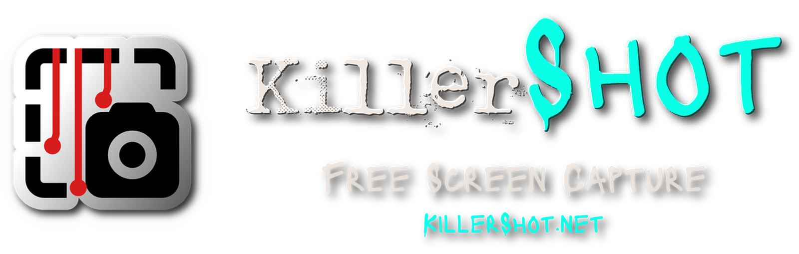

<p align="center">
  <a href="https://killershot.net"></a>
</p>

**Encrypted Screenshot Album for Windows.** KillerShot is a free, open-source screenshot and screen recording tool. It captures exactly what you select, pixel for pixel, keeps every capture in an encrypted album you can search, and puts the picture on the clipboard before you let go of the mouse.

[Download KillerShot.exe](https://github.com/SteveTheKiller/KillerShot/releases/latest/download/KillerShot.exe) from the latest release. It runs portable, installs per user or for everyone from its footer badge, or installs machine-wide with `KillerShot.exe /silent` from an elevated prompt.

How-tos and every shortcut are on the [help page](https://killershot.net/help.html). The capture and recording pipelines, album encryption, DPI handling and encoder limits are on the [technical page](https://killershot.net/technical.html).

## Features

- **Print Screen, taken over.** Print Screen captures a region, Alt+Print Screen the active window, Ctrl+Print Screen the monitor under the pointer and Shift+Print Screen every monitor. Ctrl+Shift+Print Screen starts or stops a recording, and every shortcut can be changed or turned off.
- **A frozen desktop.** Region capture works over a still copy of the whole desktop, so open menus and tooltips stay in the picture and the selection overlay never does. Covered windows come out whole through Windows Graphics Capture.
- **An encrypted album.** Every capture goes into a SQLCipher (AES-256) library that opens with your Windows account or a password you set. Browse it as shelves of carousels, a grid or a timeline, by collection or by date, and search window titles, program names, notes and the text inside each picture.
- **Files (F9).** Browse folders in tabs with list, icons and details views, the way KillerShell does. Rename, copy, move and recycle files, star your folders, export a listing as CSV or HTML, and open images in the editor.
- **Recordings in the library.** Record a region, window or monitor to MP4 with system sound, the microphone or both, or to an animated GIF. Keep recordings as plain video files or move them into the encrypted album.
- **An editor built for screenshots.** It has pen, highlighter, arrow, line, rectangle, ellipse, fill, text, numbered steps, callouts, redaction and crop, with 50 steps of undo. Exports keep the capture's exact pixel size.
- **Redaction that sticks.** Redaction is an opaque block, not a blur. Auto redact finds email addresses, card numbers, phone numbers, US Social Security numbers, IP addresses, keys and passwords, and can cover them on every new capture before it is saved or copied.
- **Text and QR reading.** Copy the text out of a picture or a dragged region with Windows text recognition, and read QR codes with local checks for disguised links. Nothing is sent anywhere.
- **Scrolling capture.** Pick a region, scroll the page yourself, and KillerShot stitches the result, keeping sticky headers once.
- **Linked folders.** Link any local folder, mapped drive or network share as a collection. The pictures stay where they are, and Windows' Screenshots folder shows as a live collection beside your own.
- **Make PDF.** With KillerPDF installed, a folder's or a collection's pictures become one PDF from its right-click card.
- **Clipboard and files.** Every capture goes to the clipboard as PNG and as a standard bitmap, and can save to a folder as PNG or JPEG, named from a pattern.
- **Scripts and agents.** A headless command line with JSON output and dependable exit codes covers capture, recording, the album, text and QR reading. Run `KillerShot.exe --help` for the commands. KillerMCP gives connected agents the same tools.
- **Fourteen themes.** Dark with Teal is the default, and the new Trash Polka puts a tattoo-style ink background behind everything in your accent color. Eight accents, Film Grain on or off, and 20 languages. F1 shows every shortcut as a list or a keyboard map.
- **Private by design.** There's no account, no analytics and nothing uploaded. The only network request is the update check against GitHub releases, which you can turn off in About.

## Requirements

- Windows 11 (build 22000 or later), x64
- The `KillerShot.exe` download needs the .NET 10 Desktop Runtime. The Microsoft Store copy carries its own runtime.

## Build from source

```powershell
git clone https://github.com/SteveTheKiller/KillerShot.git
cd KillerShot
dotnet build KillerShot.csproj -c Release
dotnet build KillerShot.Cli\KillerShot.Cli.csproj -c Release
```

Building requires the .NET 10 SDK. `KillerShot.csproj` builds the app, which also runs the command line. `KillerShot.Cli.csproj` builds `KillerShot.Cli.exe`, a console entry point for the same commands, so their output shows in a terminal without redirection.

`brand/` holds the working artwork and is not tracked. Everything the app uses is generated into `Resources/`, which is tracked, so a fresh clone builds without it.

## Command line in scripts

`KillerShot.exe` is a Windows app, so PowerShell and Command Prompt don't wait for it, and `$LASTEXITCODE` doesn't hold its result. Start it and wait for the exit code instead:

```powershell
$run = Start-Process KillerShot.exe -ArgumentList '--cli', 'capture', '--monitor', '1', '--json' -Wait -PassThru -NoNewWindow
$run.ExitCode
```

Exit code `0` means success, `1` a failed command and `2` a usage error. Add `-RedirectStandardOutput` to keep the JSON.

## Uninstalling from scripts

Run `KillerShot.exe /uninstall-silent` from the installed folder. Albums and captures are kept.

Exit code `997` means removal is pending and finishes after the app closes. It's an accepted handoff, not a finished removal. The command prints the operation folder that holds `status.json`, which reads `Completed` with exit code `0`, or `Failed` with its error. Deployment manifests that use this command must accept `997` as a success code.

## Translations

UI strings live in `Strings/`, one XAML `ResourceDictionary` per locale. Missing keys fall back to English.

## Changelog

See [CHANGELOG.md](CHANGELOG.md).

## License

GPLv3. See [LICENSE.txt](LICENSE.txt). If you fork, modify or redistribute KillerShot, your version must also be released under GPLv3 with its source available.

The album uses SQLCipher, built from upstream source as `third_party/sqlcipher/e_sqlcipher.dll` (see the README there), under its BSD-style license.

Bundled fonts keep their own licenses:

- Killer Sans and Killer Sans UI: SIL OFL 1.1 ([license](Fonts/KillerSans-OFL.txt))
- Lacquer: SIL OFL 1.1 ([license](Fonts/Lacquer-OFL.txt))
- Punktype ([license](Fonts/Punktype-LICENSE.txt))
